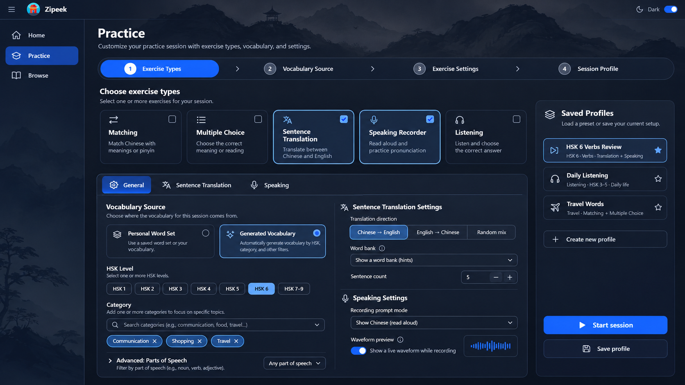
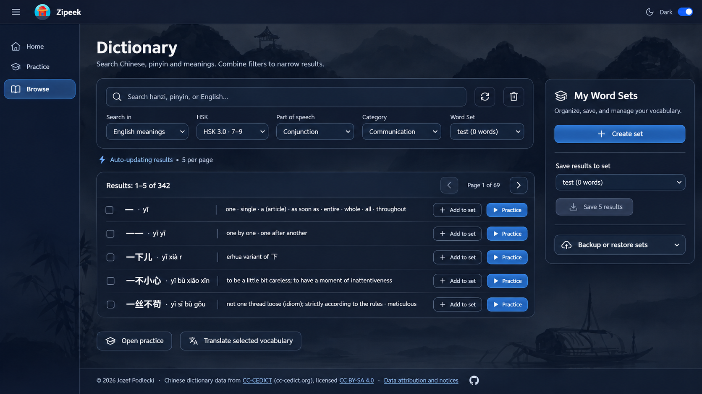

# User-provided visual references (2026-11-04)

These screenshots are the visual direction for ongoing development; they are **not** evidence that every pictured feature exists.

## Practice configuration

The reference depicts a four-step builder, exercise tiles, a shared personal/dictionary vocabulary source, multiple HSK bands, category search with removable chips, conditional translation/speaking controls, and saved profiles. Current implementation remains a phased builder with separate launch actions, one HSK band, and no persisted profiles or shared mixed-session planner. Continue the query adapter and launcher integration before exposing filters as functional.

## Dictionary Browse

The reference includes dense search results and a Word Sets management sidebar. **The user's later instruction supersedes the sidebar:** Word Sets must be managed on a standalone route (`#/word-sets`), not on Dictionary. Browse retains compact results, filtering, listening and adding/removing entries from a chosen set. Some visual details such as exact pagination and styling are aspirational.

## Additional approved direction

- Home contains a functioning Word of the Day, and `#/random` draws a random dictionary word.
- Breaking database schema changes and regeneration are acceptable in this development phase; no migration compatibility requirement unless explicitly scoped otherwise.
- `IconData::LUCIDE_HOME` is the intentional compile-compatible icon identifier.
- The historical 12,100-versus-12,188 database test expectation mismatch is deferred.

## November 4 — approved four-tab Practice architecture and companion UI proposals

- `practice-session-dashboard-approved-reference.png`: approved visual direction for the session-builder content, now reorganized into four top-level steps documented in `../product/PRACTICE_SESSION_BUILDER.md`. Its old right-side Summary panel is superseded by a dedicated Summary step. All shown counts are illustrative, not test evidence.
- `dictionary-browse-proposal-20261104.png`: proposed compact results toolbar, unified pagination and active-filter chips. Reference only, not implementation.
- `word-sets-proposal-20261104.png`: proposed list+detail management layout with more useful empty states and icons. Reference only, not implementation.
