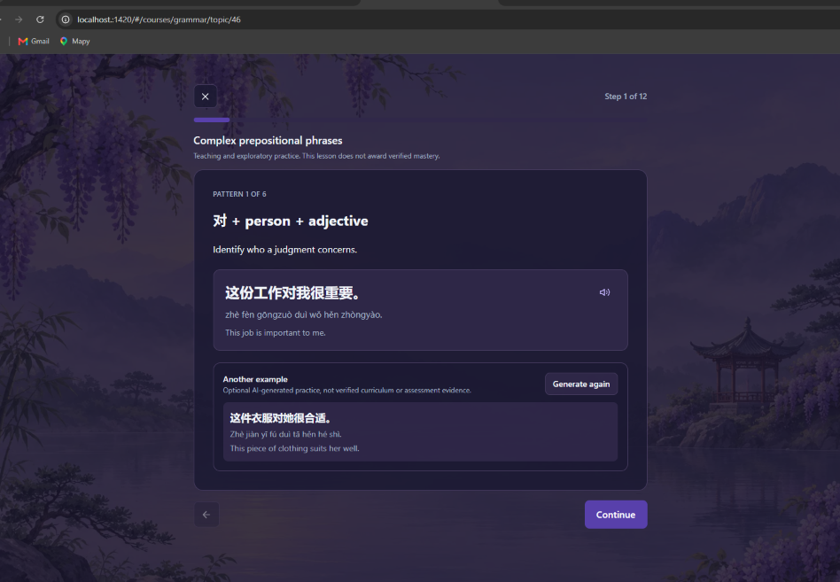

# ISS-018 - Pedagogical course tiles before evidence

**Status:** Open  
**Priority:** P1  
**Area:** Courses  
**Reported:** 2026-11-17  
**Decision:** D54

## Original observation

> i have pedagogical data enabled therefore everything should be hidden as system does not know how much things i unlocked/acquired

## Expected behavior

Show locked, dimmed tiles without claiming mastery until evidence is established, as approved.

## Visual evidence

[Open screenshot](../assets/screenshots/ISS-018-pedagogical-course-tiles-before-evidence.png)

## Acceptance

- [ ] Reproduce against the current build or record why it cannot be reproduced.
- [ ] Implement a focused change with appropriate unit and browser checks.
- [ ] Verify behavior in Chrome with relevant service and data conditions.
- [ ] Verify keyboard navigation, accessible feedback, narrow viewport and the `/zipeek/` deployment path where relevant.
- [ ] Record release, verification command and observed result before marking this issue resolved.

## Resolution

Unresolved. No passing browser evidence recorded.
