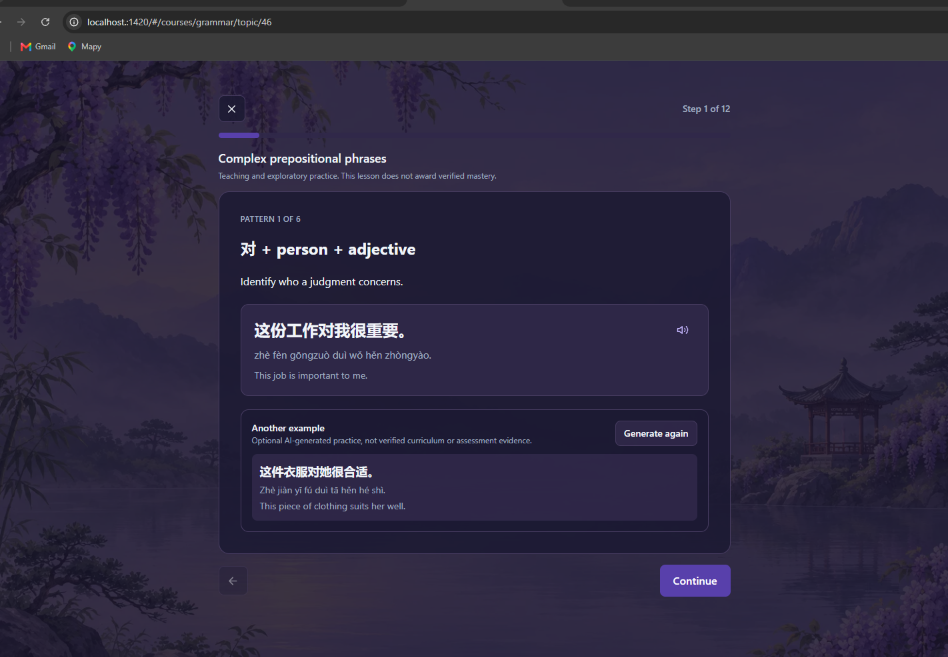

# ISS-019 - Grammar examples playback and controls

**Status:** Open  
**Priority:** P1  
**Area:** Courses  
**Reported:** 2026-11-17  
**Decision:** None recorded

## Original observation

> generated ai example does not have playable audio; "generate again", maybe just icon idk repeat/dice; "Generate example" maybe just icon idk repeat/dice; "Correct. You can continue." not needed; maybe hanzi font size configurable?

## Expected behavior

Enable playback, compact regenerate control, avoid redundant feedback, support readable Hanzi size.

## Visual evidence

[Open screenshot](../assets/screenshots/ISS-019-grammar-examples-playback-and-controls.png)

## Acceptance

- [ ] Reproduce against the current build or record why it cannot be reproduced.
- [ ] Implement a focused change with appropriate unit and browser checks.
- [ ] Verify behavior in Chrome with relevant service and data conditions.
- [ ] Verify keyboard navigation, accessible feedback, narrow viewport and the `/zipeek/` deployment path where relevant.
- [ ] Record release, verification command and observed result before marking this issue resolved.

## Resolution

Unresolved. No passing browser evidence recorded.
