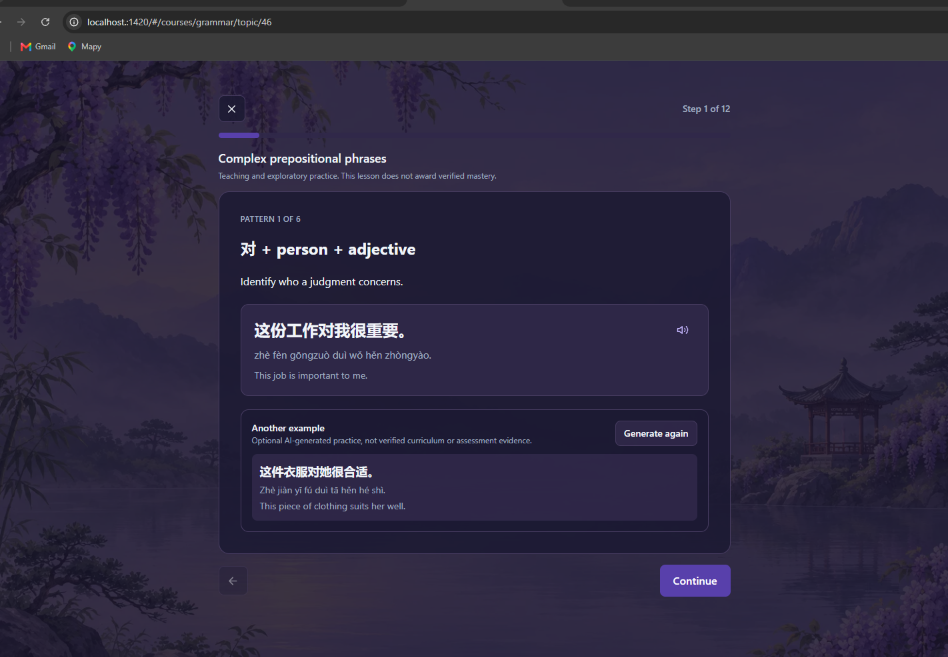

# ISS-020 - Rolling grammar course visibility evidence

**Status:** Open  
**Priority:** P1  
**Area:** Courses  
**Reported:** 2026-11-17  
**Decision:** D55

## Original observation

> only translate sentence/sentence builder/transform sentence can "reveal" tiles in grammar course. if user consistently is able to translate sentence 10 times successfully every day over 7 days and sentence contains grammar structure related to grammar course then the tiles changes opacity

## Expected behavior

Use approved per-pattern rolling 7 of 14 days, ten qualifying scored successes on each day, only for three eligible exercise types. Define opacity mapping and deduplicate evidence.

## Visual evidence

[Open screenshot](../assets/screenshots/ISS-020-rolling-grammar-course-visibility-evidence.png)

## Acceptance

- [ ] Reproduce against the current build or record why it cannot be reproduced.
- [ ] Implement a focused change with appropriate unit and browser checks.
- [ ] Verify behavior in Chrome with relevant service and data conditions.
- [ ] Verify keyboard navigation, accessible feedback, narrow viewport and the `/zipeek/` deployment path where relevant.
- [ ] Record release, verification command and observed result before marking this issue resolved.

## Resolution

Unresolved. No passing browser evidence recorded.
