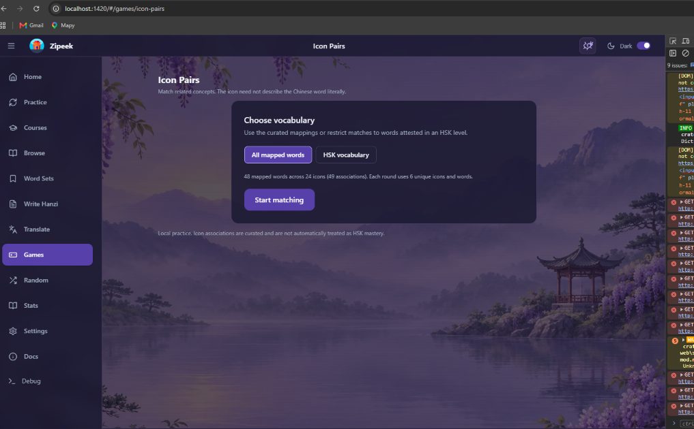

# ISS-022 - Icon Pairs listening and readability settings

**Status:** Open  
**Priority:** P2  
**Area:** Games  
**Reported:** 2026-11-17  
**Decision:** None recorded

## Original observation

> settings - missing option - play audio on hanzi click; settings - missing option - show pinyin; settings - missing option - font size

## Expected behavior

Provide per-game audio, Pinyin and tile text-size controls.

## Visual evidence

[Open screenshot](../assets/screenshots/ISS-022-icon-pairs-listening-and-readability-settings.png)

## Acceptance

- [ ] Reproduce against the current build or record why it cannot be reproduced.
- [ ] Implement a focused change with appropriate unit and browser checks.
- [ ] Verify behavior in Chrome with relevant service and data conditions.
- [ ] Verify keyboard navigation, accessible feedback, narrow viewport and the `/zipeek/` deployment path where relevant.
- [ ] Record release, verification command and observed result before marking this issue resolved.

## Resolution

Unresolved. No passing browser evidence recorded.
