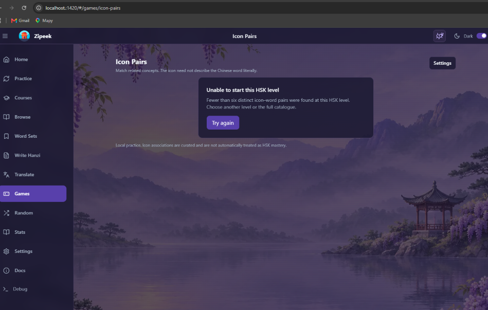

# ISS-023 - Icon Pairs HSK 6 unavailable selection

**Status:** Open  
**Priority:** P1  
**Area:** Games  
**Reported:** 2026-11-17  
**Decision:** None recorded

## Original observation

> selected hsk6 and got - "Unable to start this HSK level"

## Expected behavior

Provide enough curated pairs or clearly disable unsupported levels with counts and a fallback.

## Visual evidence

[Open screenshot](../assets/screenshots/ISS-023-icon-pairs-hsk-6-unavailable-selection.png)

## Acceptance

- [ ] Reproduce against the current build or record why it cannot be reproduced.
- [ ] Implement a focused change with appropriate unit and browser checks.
- [ ] Verify behavior in Chrome with relevant service and data conditions.
- [ ] Verify keyboard navigation, accessible feedback, narrow viewport and the `/zipeek/` deployment path where relevant.
- [ ] Record release, verification command and observed result before marking this issue resolved.

## Resolution

Unresolved. No passing browser evidence recorded.
