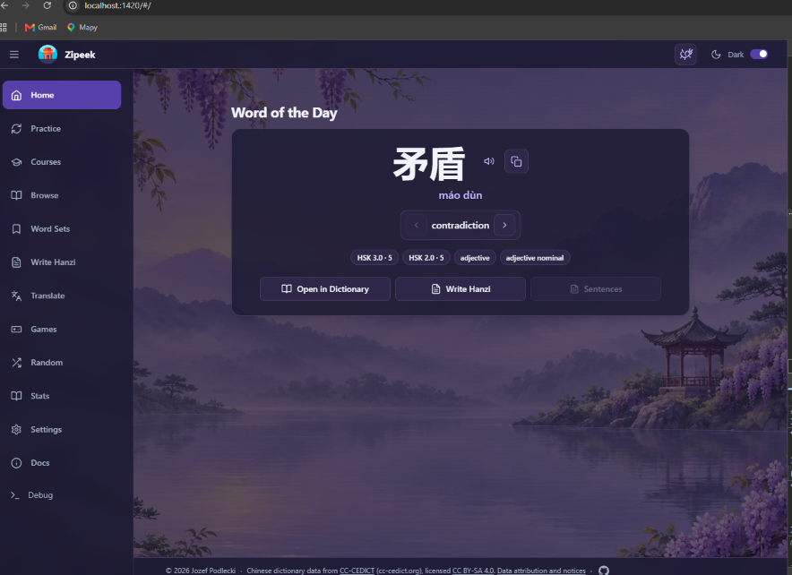

# ISS-001 - Dragon indicator in the top bar

**Status:** Open  
**Priority:** P0  
**Area:** Onboarding  
**Reported:** 2026-11-17  
**Decision:** D54

## Original observation

> onboarding ( enable pedagogic ) -> i dont see dragon in top panel. it should take some width, currently i see weird icon

## Expected behavior

Top bar renders the intended compact dragon progress, with meaningful accessible labeling and space reserved.

## Visual evidence

[Open screenshot](../assets/screenshots/ISS-001-dragon-indicator-in-the-top-bar.png)

## Acceptance

- [ ] Reproduce against the current build or record why it cannot be reproduced.
- [ ] Implement a focused change with appropriate unit and browser checks.
- [ ] Verify behavior in Chrome with relevant service and data conditions.
- [ ] Verify keyboard navigation, accessible feedback, narrow viewport and the `/zipeek/` deployment path where relevant.
- [ ] Record release, verification command and observed result before marking this issue resolved.

## Resolution

Unresolved. No passing browser evidence recorded.
