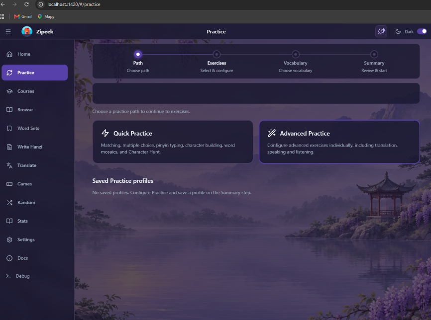

# ISS-002 - Practice path layout and empty guidance

**Status:** Open  
**Priority:** P1  
**Area:** Practice  
**Reported:** 2026-11-17  
**Decision:** None recorded

## Original observation

> practice -> path - there is weird empty panel and font color "Choose a practice path to continue to exercises." does not match theme, the label doesnt seem UI/UX friendly

## Expected behavior

No purposeless empty surface, theme-consistent instruction contrast, and clear path selection.

## Visual evidence

[Open screenshot](../assets/screenshots/ISS-002-practice-path-layout-and-empty-guidance.png)

## Acceptance

- [ ] Reproduce against the current build or record why it cannot be reproduced.
- [ ] Implement a focused change with appropriate unit and browser checks.
- [ ] Verify behavior in Chrome with relevant service and data conditions.
- [ ] Verify keyboard navigation, accessible feedback, narrow viewport and the `/zipeek/` deployment path where relevant.
- [ ] Record release, verification command and observed result before marking this issue resolved.

## Resolution

Unresolved. No passing browser evidence recorded.
