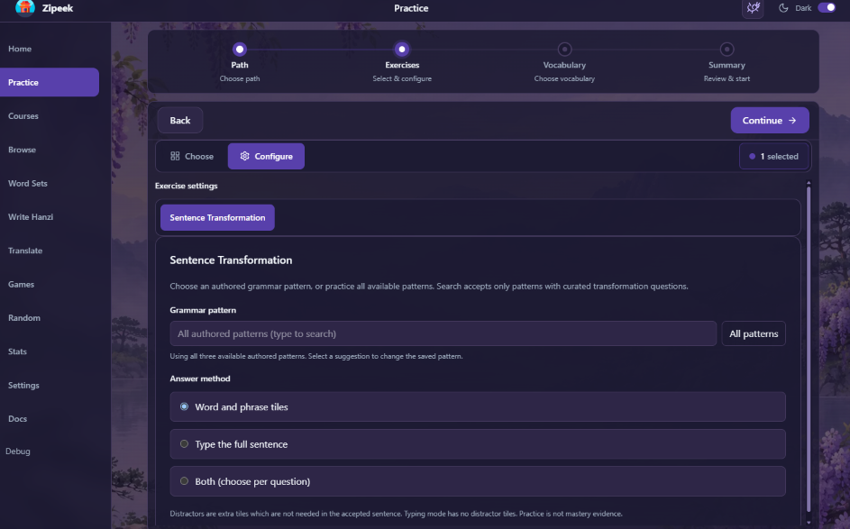

# ISS-005 - Sentence Transformation setup and grammar patterns

**Status:** Open  
**Priority:** P1  
**Area:** Practice  
**Reported:** 2026-11-17  
**Decision:** D53

## Original observation

> UI/UX is terrible; tab already mentions Sentence Transformation then why additional header; grammar pattern, i expected custom autocomplete input not browser builtin with all these grammar pattern suggestions as in grammar course? it should display at most 5 when user is typing, grammar pattern should be humanized somehow, user can pick multiple grammar patterns but generated sentence can only have one of mentioned grammar patterns

## Expected behavior

Remove duplicated heading; custom accessible pattern autocomplete at most five suggestions during input; allow multiple selected patterns, choose one per generated question.

## Visual evidence

[Open screenshot](../assets/screenshots/ISS-005-sentence-transformation-setup-and-grammar-patterns.png)

## Acceptance

- [ ] Reproduce against the current build or record why it cannot be reproduced.
- [ ] Implement a focused change with appropriate unit and browser checks.
- [ ] Verify behavior in Chrome with relevant service and data conditions.
- [ ] Verify keyboard navigation, accessible feedback, narrow viewport and the `/zipeek/` deployment path where relevant.
- [ ] Record release, verification command and observed result before marking this issue resolved.

## Resolution

Unresolved. No passing browser evidence recorded.
