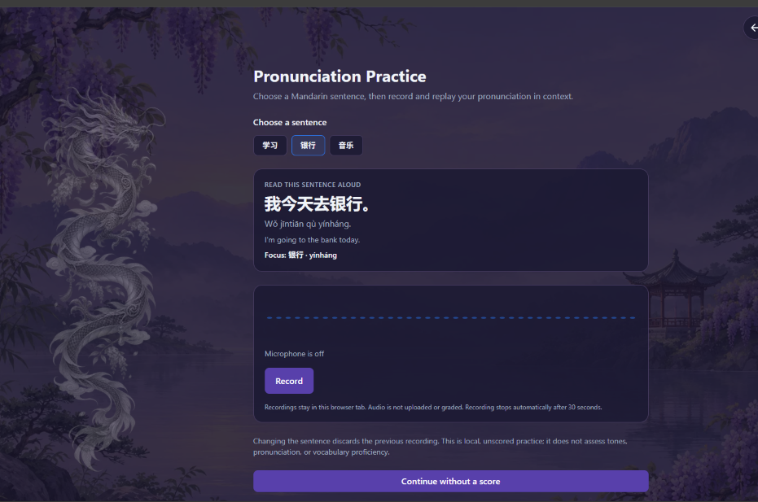

# ISS-008 - Pronunciation exercise name and content selection

**Status:** Open  
**Priority:** P1  
**Area:** Practice  
**Reported:** 2026-11-17  
**Decision:** D53

## Original observation

> Pronunciation Practice - should be "Pronunciation"; config should specify whether we only pronounce hanzi or sentences, if sentences then it must utilize AI

## Expected behavior

Rename to Pronunciation; configure word or AI sentence prompts, with unavailable state if AI cannot be reached.

## Visual evidence

[Open screenshot](../assets/screenshots/ISS-008-pronunciation-exercise-name-and-content-selection.png)

## Acceptance

- [ ] Reproduce against the current build or record why it cannot be reproduced.
- [ ] Implement a focused change with appropriate unit and browser checks.
- [ ] Verify behavior in Chrome with relevant service and data conditions.
- [ ] Verify keyboard navigation, accessible feedback, narrow viewport and the `/zipeek/` deployment path where relevant.
- [ ] Record release, verification command and observed result before marking this issue resolved.

## Resolution

Unresolved. No passing browser evidence recorded.
