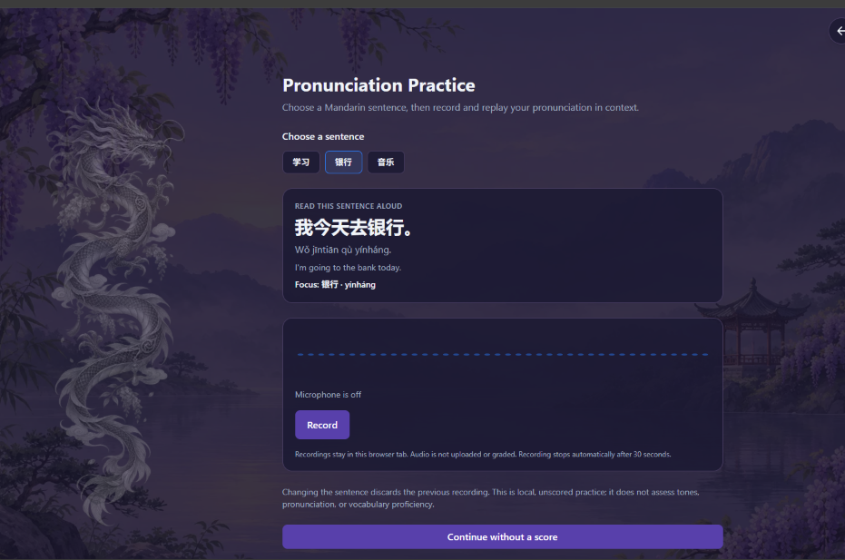

# ISS-009 - Speech-to-text verification exercise

**Status:** Open  
**Priority:** P1  
**Area:** Practice  
**Reported:** 2026-11-17  
**Decision:** D56

## Original observation

> i just realized we dont have exercise which uses speech-to-text, i say something and verifies it

## Expected behavior

Offer browser and configured local STT through an explicit privacy and availability boundary, with transcript assessment distinct from mastery.

## Visual evidence

[Open screenshot](../assets/screenshots/ISS-009-speech-to-text-verification-exercise.png)

## Acceptance

- [ ] Reproduce against the current build or record why it cannot be reproduced.
- [ ] Implement a focused change with appropriate unit and browser checks.
- [ ] Verify behavior in Chrome with relevant service and data conditions.
- [ ] Verify keyboard navigation, accessible feedback, narrow viewport and the `/zipeek/` deployment path where relevant.
- [ ] Record release, verification command and observed result before marking this issue resolved.

## Resolution

Unresolved. No passing browser evidence recorded.
