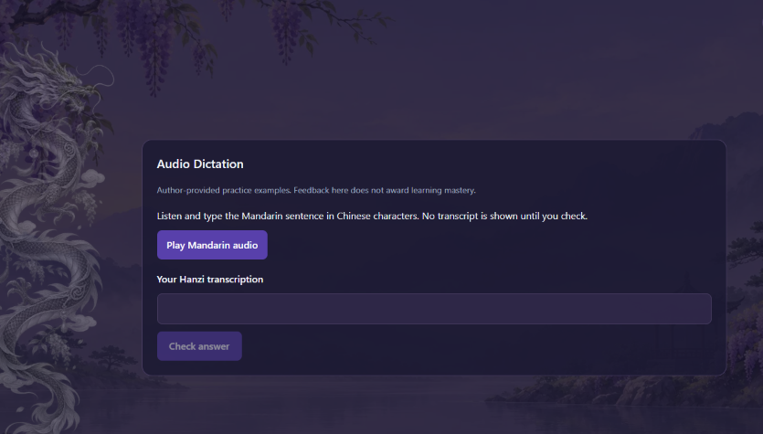

# ISS-010 - Audio Dictation as sentence reconstruction

**Status:** Open  
**Priority:** P1  
**Area:** Practice  
**Reported:** 2026-11-17  
**Decision:** D53

## Original observation

> audio dictation - thought i would generate sentence, play the audio and then user has to form the sentence using wordbank? currently thats not what i want

## Expected behavior

Generate and play a Chinese sentence; learner reconstructs using a word bank, with clear replay and verification.

## Visual evidence

[Open screenshot](../assets/screenshots/ISS-010-audio-dictation-as-sentence-reconstruction.png)

## Acceptance

- [ ] Reproduce against the current build or record why it cannot be reproduced.
- [ ] Implement a focused change with appropriate unit and browser checks.
- [ ] Verify behavior in Chrome with relevant service and data conditions.
- [ ] Verify keyboard navigation, accessible feedback, narrow viewport and the `/zipeek/` deployment path where relevant.
- [ ] Record release, verification command and observed result before marking this issue resolved.

## Resolution

Unresolved. No passing browser evidence recorded.
