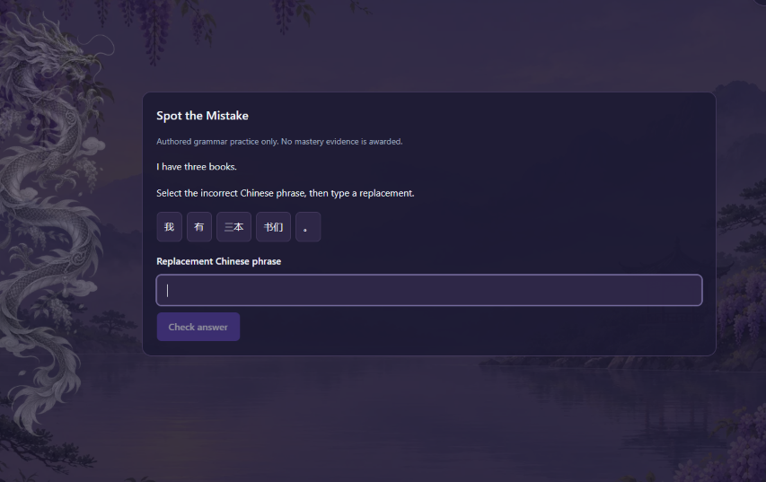

# ISS-011 - AI Spot the Mistake and answer modes

**Status:** Open  
**Priority:** P1  
**Area:** Practice  
**Reported:** 2026-11-17  
**Decision:** D53

## Original observation

> spot the mistake - it should use AI to generate the sentence; "type a replacement." - either wordbank or type, depends on exercise config

## Expected behavior

Require AI-created, unambiguously correctable errors and configurable word bank or typed answer.

## Visual evidence

[Open screenshot](../assets/screenshots/ISS-011-ai-spot-the-mistake-and-answer-modes.png)

## Acceptance

- [ ] Reproduce against the current build or record why it cannot be reproduced.
- [ ] Implement a focused change with appropriate unit and browser checks.
- [ ] Verify behavior in Chrome with relevant service and data conditions.
- [ ] Verify keyboard navigation, accessible feedback, narrow viewport and the `/zipeek/` deployment path where relevant.
- [ ] Record release, verification command and observed result before marking this issue resolved.

## Resolution

Unresolved. No passing browser evidence recorded.
