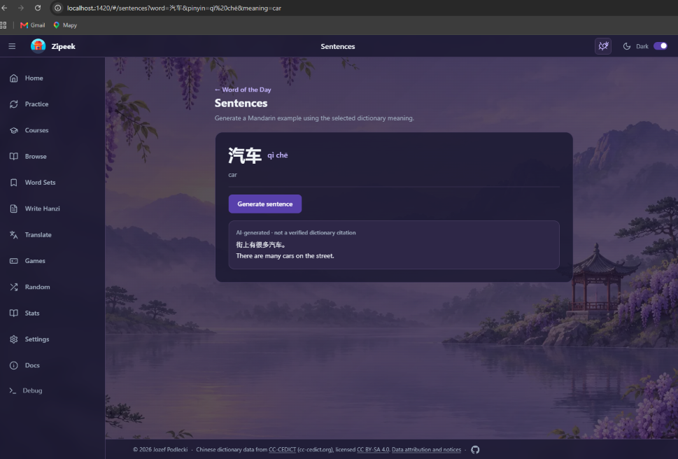

# ISS-027 - Random Sentences results and presentation

**Status:** Open  
**Priority:** P1  
**Area:** Sentences  
**Reported:** 2026-11-17  
**Decision:** D53

## Original observation

> random -> sentences - UI/UX is terrible; it generated only 1 sentence, it should generate at least 5; "generate sentence" i prefer "generate <icon>"; AI-generated not a verified dictionary citation i prefer to put it somewhere else at the top perhaps behind an info icon; there is no audio play button; hanzi font is small; there are no pinyin under hanzi

## Expected behavior

Generate at least five sentences, larger Hanzi with Pinyin, audio, compact regenerate action and accessible provenance info.

## Visual evidence

[Open screenshot](../assets/screenshots/ISS-027-random-sentences-results-and-presentation.png)

## Acceptance

- [ ] Reproduce against the current build or record why it cannot be reproduced.
- [ ] Implement a focused change with appropriate unit and browser checks.
- [ ] Verify behavior in Chrome with relevant service and data conditions.
- [ ] Verify keyboard navigation, accessible feedback, narrow viewport and the `/zipeek/` deployment path where relevant.
- [ ] Record release, verification command and observed result before marking this issue resolved.

## Resolution

Unresolved. No passing browser evidence recorded.
