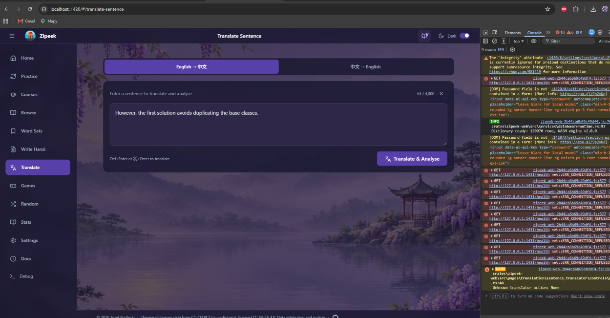

# ISS-028 - Translate Sentence does not work

**Status:** Open  
**Priority:** P0  
**Area:** Translation  
**Reported:** 2026-11-17  
**Decision:** D53

## Original observation

> translate - it does not work, theres weird warn/error in browser console

## Expected behavior

Confirm service connection, typed action callback behavior and successful translation in Chrome.

## Visual evidence

[Open screenshot](../assets/screenshots/ISS-028-translate-sentence-does-not-work.png)

## Acceptance

- [ ] Reproduce against the current build or record why it cannot be reproduced.
- [ ] Implement a focused change with appropriate unit and browser checks.
- [ ] Verify behavior in Chrome with relevant service and data conditions.
- [ ] Verify keyboard navigation, accessible feedback, narrow viewport and the `/zipeek/` deployment path where relevant.
- [ ] Record release, verification command and observed result before marking this issue resolved.

## Resolution

Unresolved. No passing browser evidence recorded.
