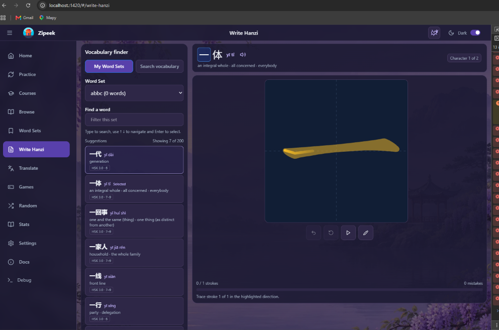

# ISS-012 - Write Hanzi Word Set results navigation

**Status:** Open  
**Priority:** P1  
**Area:** Vocabulary  
**Reported:** 2026-11-17  
**Decision:** None recorded

## Original observation

> write hanzi -> vocabulary market -my word sets - missing either vertical scroll or pagination

## Expected behavior

Provide reachable results using scroll containment or pagination and keyboard navigation.

## Visual evidence

[Open screenshot](../assets/screenshots/ISS-012-write-hanzi-word-set-results-navigation.png)

## Acceptance

- [ ] Reproduce against the current build or record why it cannot be reproduced.
- [ ] Implement a focused change with appropriate unit and browser checks.
- [ ] Verify behavior in Chrome with relevant service and data conditions.
- [ ] Verify keyboard navigation, accessible feedback, narrow viewport and the `/zipeek/` deployment path where relevant.
- [ ] Record release, verification command and observed result before marking this issue resolved.

## Resolution

Unresolved. No passing browser evidence recorded.
