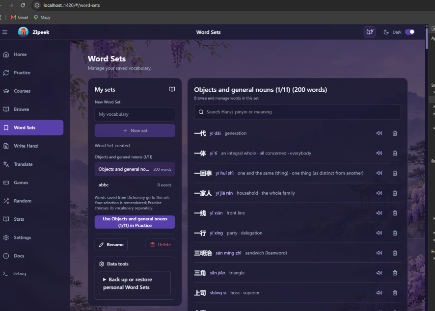

# ISS-013 - Word Sets overflow and workspace layout

**Status:** Open  
**Priority:** P1  
**Area:** Vocabulary  
**Reported:** 2026-11-17  
**Decision:** None recorded

## Original observation

> wordsets - UI/UX is terrible - there is no vertical scroll in right side widget

## Expected behavior

All words must be reachable through a single predictable scroll model; use empty horizontal space thoughtfully.

## Visual evidence

[Open screenshot](../assets/screenshots/ISS-013-word-sets-overflow-and-workspace-layout.png)

## Acceptance

- [ ] Reproduce against the current build or record why it cannot be reproduced.
- [ ] Implement a focused change with appropriate unit and browser checks.
- [ ] Verify behavior in Chrome with relevant service and data conditions.
- [ ] Verify keyboard navigation, accessible feedback, narrow viewport and the `/zipeek/` deployment path where relevant.
- [ ] Record release, verification command and observed result before marking this issue resolved.

## Resolution

Unresolved. No passing browser evidence recorded.
