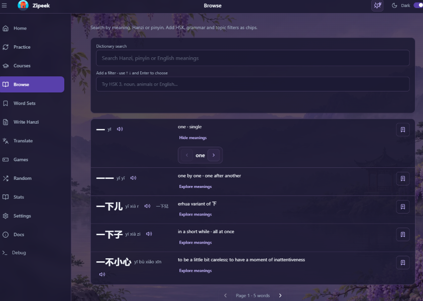

# ISS-016 - Browse meaning presentation

**Status:** Open  
**Priority:** P1  
**Area:** Vocabulary  
**Reported:** 2026-11-17  
**Decision:** None recorded

## Original observation

> browse - there are both meanings and widget "explore meanings" which does not make sense

## Expected behavior

Avoid showing an already visible meaning twice; expansion should expose additional useful data only.

## Visual evidence

[Open screenshot](../assets/screenshots/ISS-016-browse-meaning-presentation.png)

## Acceptance

- [ ] Reproduce against the current build or record why it cannot be reproduced.
- [ ] Implement a focused change with appropriate unit and browser checks.
- [ ] Verify behavior in Chrome with relevant service and data conditions.
- [ ] Verify keyboard navigation, accessible feedback, narrow viewport and the `/zipeek/` deployment path where relevant.
- [ ] Record release, verification command and observed result before marking this issue resolved.

## Resolution

Unresolved. No passing browser evidence recorded.
