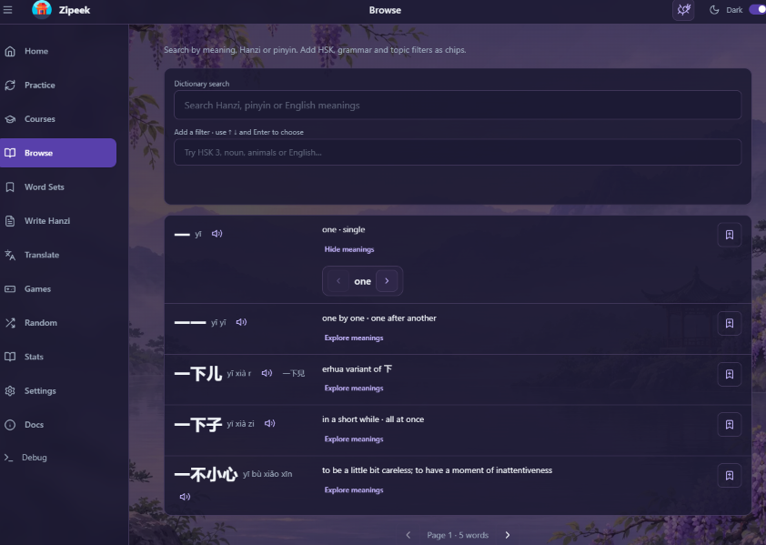

# ISS-017 - Browse five varied database words

**Status:** Open  
**Priority:** P1  
**Area:** Vocabulary  
**Reported:** 2026-11-17  
**Decision:** None recorded

## Original observation

> i expect it to always query random 5 words from the database, it seems to constantly take the same ones

## Expected behavior

Return five varied dictionary entries with clear repeat and seed behavior; do not silently hard-code the first page.

## Visual evidence

[Open screenshot](../assets/screenshots/ISS-017-browse-five-varied-database-words.png)

## Acceptance

- [ ] Reproduce against the current build or record why it cannot be reproduced.
- [ ] Implement a focused change with appropriate unit and browser checks.
- [ ] Verify behavior in Chrome with relevant service and data conditions.
- [ ] Verify keyboard navigation, accessible feedback, narrow viewport and the `/zipeek/` deployment path where relevant.
- [ ] Record release, verification command and observed result before marking this issue resolved.

## Resolution

Unresolved. No passing browser evidence recorded.
