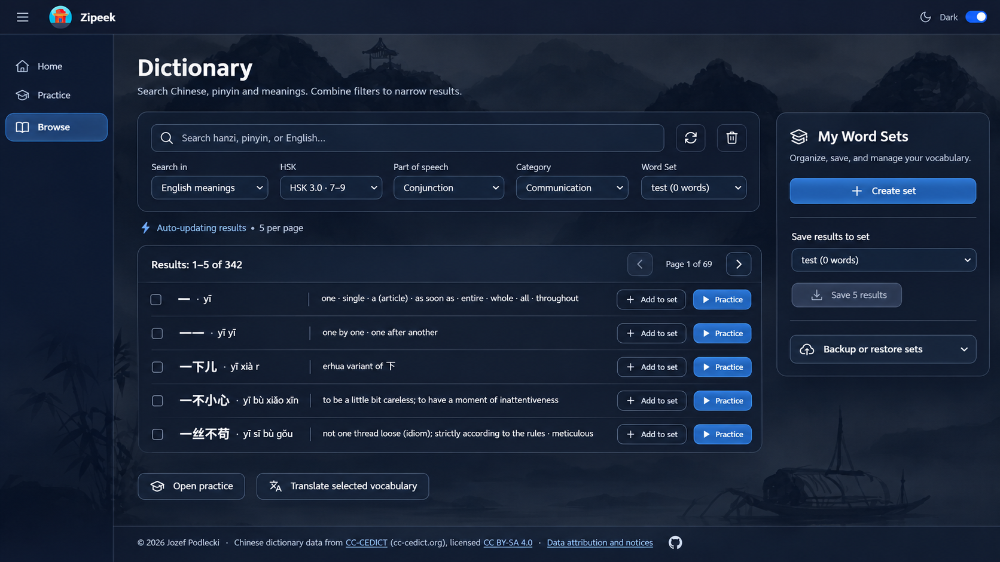

# Visual references and current UI direction

The product's current interface is the basis for visual decisions. Historical concept images are not authoritative representations of the working application. Three obsolete illustrations have been removed: the early course mosaic concept, the Practice session dashboard concept, and the Practice setup mockup. They must not be used to establish visual parity or as current UI screenshots.

## Current sources of truth

- [Screenshot-driven UI review](ui-screenshot-review.md) describes observed screens and approved changes.
- [Practice setup](../../learning-practice/practice/practice-session-builder.md) defines the wizard and configuration behavior.
- [Practice outcomes](../../learning-practice/practice/practice-outcomes.md) defines session feedback, outcomes and completion.
- [Courses mosaic](../../learning-practice/courses/courses-mosaic.md) defines intended course behavior independently of any obsolete illustration.
- [Interface and platform policy](../foundation/interface-and-platform-policy.md) defines shared appearance and navigation behavior.

## Dictionary Browse concept

This retained illustration is a concept, not a screenshot or acceptance oracle. Word Sets are managed on their own route; a sidebar shown in an older concept must not override that design.

## Other historical concept images

The retained Dictionary Browse and Word Sets concept assets can offer broad context but are not verified renderings of the current UI. Specific layout and interaction expectations come from maintained specifications and directly observed application screenshots. Do not assert pixel-level parity with an old mockup.
